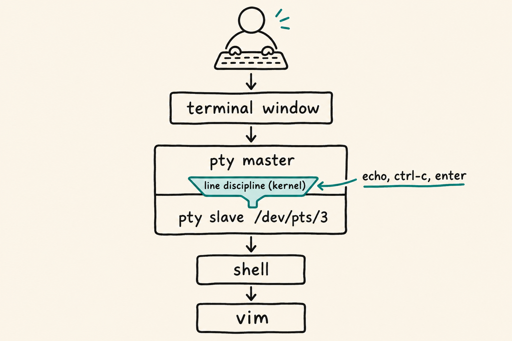
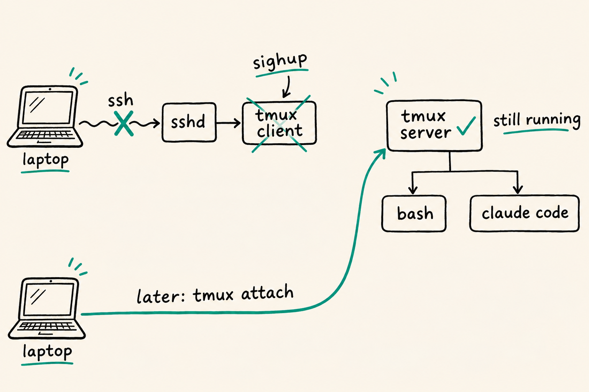
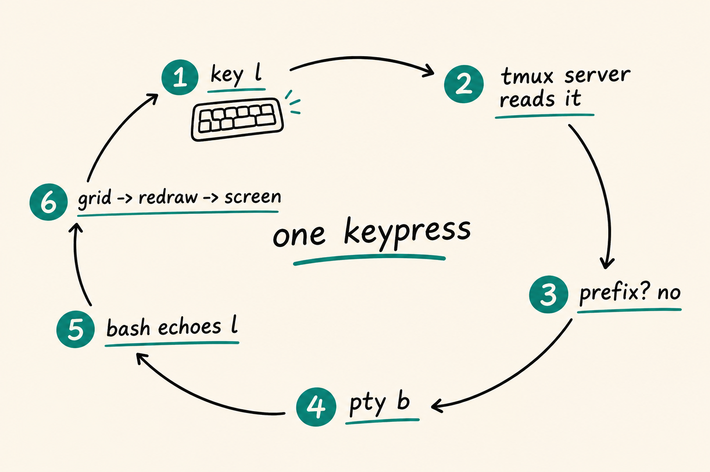
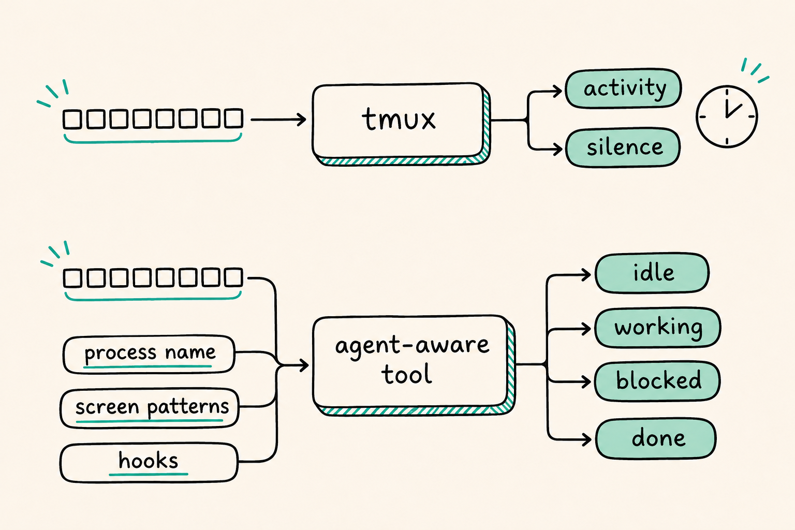

You start a long job over SSH, your Wi-Fi drops, and when you log back in the job is gone. Run the same job inside tmux and it keeps going. You reattach and find it exactly where you left it, cursor and all.

That trick looks like magic until you see the layers underneath. This post walks through them from the bottom up, in plain English, with a diagram at each step. You don't need any C or kernel knowledge. By the end you'll know what a terminal really is, where tmux sits, why detaching works, and why tmux can't tell whether the program in a pane is thinking or waiting for you.

Hold on to one sentence: **a multiplexer is a program that pretends to be a terminal for your shells, while pretending to be an ordinary program to your real terminal.**

> **Key Takeaways**
>
> - A terminal session runs through a pseudo-terminal (PTY): a fake cable with a "master" end for the terminal window and a "slave" end for the shell.
> - tmux gives every pane its own PTY, reads each pane's output, keeps a copy of each pane's screen in memory, and redraws one combined picture into your real terminal.
> - tmux is two programs. A small client connects your terminal to a background server that owns every pane. Your programs survive an SSH drop because the server never loses its connection to them.
> - Colour, clipboard and scrolling problems usually come from tmux translating between two terminals: the one it pretends to be and the one you actually use.
> - tmux only sees bytes and timing, so it can't know whether a program is waiting for input. Agent-aware tools add that knowledge on top.

## What is a terminal, really?

A terminal is a program pretending to be an old piece of hardware. Terminals started as physical machines: teletypes, then video terminals like DEC's VT100, released in 1978 ([vt100.net](https://vt100.net/dec/vt_history)). A cable connected the machine to the computer, and the operating system had rules for talking over that cable.

When terminals became windows on a screen, nobody wanted to rewrite those rules. So Unix added the **pseudo-terminal**, or PTY: a fake cable that behaves exactly like the real one ([Linus Åkesson, "The TTY demystified"](https://www.linusakesson.net/programming/tty/)).

A PTY has two ends ([`pty(7)`](https://man7.org/linux/man-pages/man7/pty.7.html)):

- The **master** end. Your terminal window (iTerm2, Ghostty, GNOME Terminal) holds it.
- The **slave** end, a file like `/dev/pts/3`. Your shell holds it. The man page says it "behaves exactly like a classical terminal," so the shell has no idea it's talking to a window instead of a 1978 machine.

Bytes written to one end come out of the other ([`pts(4)`](https://man7.org/linux/man-pages/man4/pts.4.html)). You type a key, and the window writes it to the master. The shell prints output, and it comes out of the master for the window to draw.

### The line discipline: a small filter inside the kernel

Between the two ends of the PTY sits the **line discipline**, a filter inside the kernel. Every character passes through it ([Linux kernel TTY docs](https://docs.kernel.org/driver-api/tty/index.html)). Åkesson calls it "a primitive kernel-level sed(1)."

It does three jobs you rely on every day without noticing:

- **Echo.** It shows the characters you type before the program even reads them.
- **Signals.** It turns Ctrl-C into a SIGINT signal that stops the running program, unless that program has switched signal handling off (raw-mode programs often do, and get Ctrl-C as an ordinary key) ([POSIX, General Terminal Interface](https://pubs.opengroup.org/onlinepubs/9799919799/basedefs/V1_chap11.html)).
- **Line editing.** In "canonical" mode it holds your input until you press Enter, so Backspace works before the program receives the line.

Full-screen programs like vim switch the line discipline to "raw" mode, so they get every key the moment you press it. Interactive shells like bash and zsh do much the same, so they can offer arrow-key editing and history and do their own echo. Plain canonical mode is what simpler programs like `cat` get.

## Where does tmux sit?

tmux puts itself in the middle of that stack. **Every pane in tmux is its own PTY.** The tmux manual says each pane is "a separate pseudo terminal," and the comment at the top of tmux's `window.c` says the same ([tmux(1)](https://man7.org/linux/man-pages/man1/tmux.1.html), [window.c](https://github.com/tmux/tmux/blob/master/window.c)).

So with three panes open, tmux holds three PTY masters. Your shell, vim and whatever else you run each sit on their own slave end, each believing it has a whole terminal to itself.

For each pane, tmux does three things:

1. **Read.** It reads the bytes the program writes.
2. **Understand.** It runs them through its own built-in terminal emulator. The parser in `input.c` is modelled on Paul Williams' DEC parser state machine ([vt100.net](https://vt100.net/emu/dec_ansi_parser)). The result is an in-memory grid of characters and colours for that pane.
3. **Redraw.** It combines all the pane grids, plus the status bar, into one picture and draws it into your real terminal (`tty.c`).

Your real terminal window only ever talks to one program: tmux. It has no idea three programs are running behind it.

## Why is tmux two programs?

tmux splits into a **client** and a **server**, and that split is the whole reason detaching works.

- The **server** does the real work. It holds every PTY master, every pane's screen grid and all your sessions. The manual: "All sessions are managed by a single server" ([tmux(1)](https://man7.org/linux/man-pages/man1/tmux.1.html)).
- The **client** is small. When it attaches, it hands the server its connection to your terminal over the socket. From then on the server reads your keys and draws on your screen directly. The client stays around to pass along events like window resizes, and exits when you detach.

They talk over a **Unix domain socket**, a file that two programs on the same machine use to exchange messages. By default it lives in a `tmux-<your user id>` directory under `/tmp` (or under `$TMUX_TMPDIR` if you set it), with the name `default`. The `-L` flag picks a different name and `-S` gives a full path ([tmux(1)](https://man7.org/linux/man-pages/man1/tmux.1.html)). Running `tmux display -p '#{socket_path}'` prints the one you're using.

When you first run `tmux`, no server exists yet, so the client starts one. The server then **daemonizes**: tmux's `proc.c` forks and calls `daemon()`, which cuts the server loose from the terminal you started it in ([proc.c](https://github.com/tmux/tmux/blob/master/proc.c)). From then on, the server doesn't belong to any terminal window. It just runs in the background.

**Your programs are attached to the server, and the server isn't attached to you.**

### Sessions, windows and panes

The server organises things in a tree ([tmux Getting Started](https://github.com/tmux/tmux/wiki/Getting-Started)):

- A **session** is a named workspace. Several clients can attach to the same session at once, which is how pair programming over tmux works.
- A **window** is like a browser tab inside a session.
- A **pane** is a split inside a window, and each pane is one PTY with one program.

## What happens when your SSH connection drops?

When SSH drops, the kernel sends a "hang up" signal, but only to the side that lost its connection, and that side is the tmux client.

The chain works like this. When the last holder of a PTY master closes it, the system sends SIGHUP (a "hang up" signal) to the controlling process on the other end ([POSIX `close()`](https://pubs.opengroup.org/onlinepubs/9799919799/functions/close.html)). SSH's server, `sshd`, holds the master for your login session. Once `sshd` notices your connection is gone, it closes that master. Your login shell gets the hang-up, passes it on to its jobs, and the tmux client exits along with them.

The tmux server never gets that signal. It daemonized away from your login terminal, and it holds its own PTY masters for every pane. None of those masters closed, so none of your panes heard a hang-up. Your build, your editor and your agent keep running.

When you log back in and run `tmux attach`, a fresh client connects to the same socket. The server still has every pane's screen grid in memory, so it redraws them for the new client. The comment in `window.c` describes each pane as having a "virtual screen" that is "redrawn when the window is reattached." Detaching on purpose with `Ctrl-b d` follows the same path: the client exits and the server carries on.

## What happens when you press one key?

One keypress makes a round trip through six stops, and it still feels instant. One detail first: the tmux client doesn't relay your keys. When it attached, it passed your terminal's connection to the server, so the server talks to your terminal directly ([client.c](https://github.com/tmux/tmux/blob/master/client.c), [tty.c](https://github.com/tmux/tmux/blob/master/tty.c)).

1. You press `l`. Your terminal window writes `l` into its PTY.
2. The tmux server reads it straight from your terminal's connection.
3. The server checks whether `l` is part of a tmux command. The default prefix key is `Ctrl-b`, set in `options-table.c` ([options-table.c](https://github.com/tmux/tmux/blob/master/options-table.c)). After the prefix, tmux reads the next key as a command instead of passing it on. Without the prefix, `l` goes straight through.
4. The server writes `l` into the active pane's PTY master.
5. bash receives it. Because interactive shells switch off the kernel's echo, bash's line editor echoes `l` itself, and that echo travels back out through the master.
6. The server parses the echo, updates the pane's grid, works out which cells changed, and writes just those to your terminal.

Because every byte passes through the server, tmux can also inject and read text. `tmux send-keys` types into a pane as if you had, and `tmux capture-pane -p` prints a pane's current screen ([OpenBSD tmux(1)](https://man.openbsd.org/tmux.1)). Many multi-agent setups are built from exactly those two commands.

## How do programs draw on a terminal?

Programs don't draw pixels. They print text mixed with **escape sequences**: short codes starting with the Escape character that move the cursor, change colours, or switch modes. xterm's reference lists hundreds ([xterm control sequences](https://mirrors.mit.edu/NetBSD/NetBSD-release-11/xsrc/external/mit/xterm/dist/ctlseqs.txt)). A few you meet every day:

| Escape sequence | What it does |
|---|---|
| `ESC [ 5 ; 10 H` | Move the cursor to row 5, column 10 |
| `ESC [ ? 1049 h` | Switch to the "alternate screen" (why vim's display vanishes when you quit) |
| `ESC [ 38 ; 2 ; 255 ; 0 ; 0 m` | Set the text colour to pure red using 24-bit colour |
| `ESC ] 52 ; ...` | OSC 52: ask the terminal to put text on the clipboard |

tmux's double life gets tricky here. It reads these codes from each pane as a terminal would, then writes new codes to your real terminal as a program would. In the middle it has to decide what your real terminal can handle.

That's why `TERM` matters. Inside tmux, `TERM` must be `screen` or `tmux` (usually `tmux-256color`), because that's the kind of terminal tmux pretends to be ([tmux(1)](https://man7.org/linux/man-pages/man1/tmux.1.html)). Outside, tmux reads your real terminal's `TERM` to learn its abilities. If tmux doesn't know your terminal supports 24-bit colour, it lowers colours to the nearest of 256, which is why themes look washed out ([tmux FAQ](https://github.com/tmux/tmux/wiki/FAQ)).

## What happens when you resize the window?

Resizing is a relay of signals and size updates down the stack:

1. You drag your terminal window bigger. The window tells the kernel the new size, and the kernel sends SIGWINCH ("window changed") to the tmux client.
2. The client tells the server over the socket that the size changed. The server reads the new size from your terminal, which it already holds, and recalculates the layout of every pane.
3. For each pane, the server sets the new size on that pane's PTY with the `TIOCSWINSZ` ioctl, in `window_pane_send_resize()` ([TIOCSWINSZ man page](https://man7.org/linux/man-pages/man2/TIOCSWINSZ.2const.html)).
4. The kernel stores the size and sends SIGWINCH to the program in that pane. vim catches it and redraws itself to fit.

When two clients of different sizes attach to one session, tmux has to pick a size. By default, the window follows the client that was used most recently (the `window-size` option defaults to `latest`, per [tmux(1)](https://man.openbsd.org/tmux.1)).

## tmux vs GNU screen vs Zellij

All three use the same client/server idea. They differ in age, defaults and what you can extend.

| | GNU screen | tmux | Zellij |
|---|---|---|---|
| Started | 1987, by Oliver Laumann ([Wikipedia](https://en.wikipedia.org/wiki/GNU_Screen)) | 2007, by Nicholas Marriott ([Wikipedia](https://en.wikipedia.org/wiki/Tmux)) | Newer, written in Rust ([GitHub](https://github.com/zellij-org/zellij)) |
| Default prefix | `Ctrl-a` | `Ctrl-b` | Mode-based keys, shown on screen |
| Model | Client/server | Client/server over a Unix socket | Client/server, with separate threads for screen, PTYs and plugins |
| Stand-out feature | Runs nearly everywhere | Control mode (`-CC`), which iTerm2 uses to show tmux windows as native windows ([iTerm2 docs](https://iterm2.com/documentation-tmux-integration.html)) | WebAssembly plugins (its own UI is built from them) and [session resurrection](https://zellij.dev/documentation/session-resurrection.html) |

tmux was imported into OpenBSD's base system in 2009, which is why it ships with OpenBSD by default ([Wikipedia](https://en.wikipedia.org/wiki/Tmux)). Zellij saves your sessions as layouts every 60 seconds by default, and when it restores one it waits for you to press Enter before rerunning commands, which is a sensible guard ([Zellij docs](https://zellij.dev/documentation/session-resurrection.html)).

## Common tmux problems, explained by the stack

Most tmux annoyances make sense once you see tmux as a translator between two terminals:

- **Colours look dull.** tmux doesn't know your outer terminal supports 24-bit colour. Tell it with the `terminal-features` option and the `RGB` flag (tmux 3.2 and later) ([tmux FAQ](https://github.com/tmux/tmux/wiki/FAQ)).
- **Copy doesn't reach your system clipboard.** tmux uses OSC 52 to pass clipboard text out to your real terminal, which works even over SSH. Some terminals, including VTE-based ones such as GNOME Terminal, don't support it. With `set-clipboard on`, any program in any pane can write to your clipboard, so leave the default unless you need it ([tmux Clipboard wiki](https://github.com/tmux/tmux/wiki/Clipboard)).
- **You can't scroll with the mouse wheel.** The real terminal's scrollback only sees tmux's combined screen, not each pane's history. Use copy mode (`Ctrl-b [`) instead. tmux keeps 2,000 lines per pane by default (`history-limit`) ([Getting Started](https://github.com/tmux/tmux/wiki/Getting-Started)).
- **The mouse selects the wrong thing.** With `set -g mouse on`, tmux takes over the mouse. Hold Shift (most Linux terminals) or Option (iTerm2) to go around it ([tmux FAQ](https://github.com/tmux/tmux/wiki/FAQ)).
- **Escape feels slow in vim.** tmux waits briefly after an Escape to see whether it starts a longer sequence. The `escape-time` option controls the wait ([tmux(1)](https://man.openbsd.org/tmux.1)).
- **tmux inside tmux breaks things.** Each layer translates codes again. Keep `TERM` correct at each level, and use `allow-passthrough` (tmux 3.3 and later) for codes that must reach the outer terminal untouched ([tmux FAQ](https://github.com/tmux/tmux/wiki/FAQ)).

## What tmux can't see

tmux sees only bytes and timing. It knows when a pane printed something, when it went quiet, which command is running (`pane_current_command`) and whether the program has exited (`pane_dead`). Its `monitor-activity` and `monitor-silence` options flag panes based on those timings ([tmux(1)](https://man7.org/linux/man-pages/man1/tmux.1.html)).

What it can't see is **meaning**. To tmux, a coding agent thinking hard and a coding agent waiting for you to approve a command look the same: a pane that stopped printing. That gap didn't matter when panes held shells and editors. It matters a lot once each pane holds an AI agent that can sit blocked for an hour while you assume it's working.

Newer tools add that missing layer on top of the same PTY machinery. Herdr, which I've used, detects each agent's process, matches known prompt patterns at the bottom of the pane, and listens for hooks the agent reports, so it can show a pane as idle, working, blocked or done ([Herdr docs](https://herdr.dev/docs/preview/agents/)). Zellij has added an attention inbox that does something similar using self-reported codes, prompt markers and silence heuristics ([Zellij docs](https://zellij.dev/documentation/inbox.html)).

That's the next post: what an agentic development environment is, and which layer of tooling you need when your panes hold agents instead of shells.

## Frequently Asked Questions

### What is a PTY in simple terms?

A PTY (pseudo-terminal) is a fake terminal cable made of two connected ends. The master end goes to a terminal window or a program like tmux, and the slave end goes to a shell. The shell thinks it's talking to a real terminal, and the kernel applies the usual terminal rules (echo, Ctrl-C, line editing) in between.

### Why do programs keep running after I detach from tmux?

They're attached to the tmux server, not to your terminal. The server runs in the background, separate from any terminal window, and holds every pane's PTY. Detaching or losing SSH only ends the small tmux client. The server and your programs carry on, and `tmux attach` starts a new client that redraws everything.

### Is tmux a terminal emulator?

Partly. tmux contains its own terminal emulator, which it uses to read each pane's output into an in-memory screen. But it still needs a real terminal emulator such as iTerm2 or Ghostty to display the combined result. It is a terminal for your programs and a program for your terminal.

### Should I use tmux, screen or Zellij?

All three keep sessions alive with the same client/server design. tmux is widely used and very scriptable. Zellij has friendlier defaults, on-screen key hints and a plugin system. screen is mostly worth knowing for old servers where it's the only one installed.

## Conclusion

- A terminal is a program pretending to be 1970s hardware, and a PTY is the fake cable that makes the pretence work.
- tmux gives every pane its own PTY, reads each one through its own terminal emulator, and redraws one combined screen into your real terminal.
- The client/server split is why detaching works. Your programs belong to a background server that never lost its connection to them.
- Most tmux problems with colours, the clipboard or scrolling come from tmux translating between the terminal it pretends to be and the one you use.
- tmux sees bytes, not meaning, which is the gap agent-aware tools fill.

If you run AI agents in your terminal, the next post covers the tools built on top of this layer. Meanwhile, [how AI agents remember](https://blog.carnav.in/how-ai-agents-remember/) explains what each of those agents keeps in its context while it runs.

---

*The hero image and diagrams were made with AI image generation.*

*Arnav Chauhan is a software engineer who writes about AI agents and developer tooling on this blog. More [about me](https://blog.carnav.in/about/), or reach me on [Twitter / X](https://twitter.com/arnav_sde) and [GitHub](https://github.com/foxy17).*
